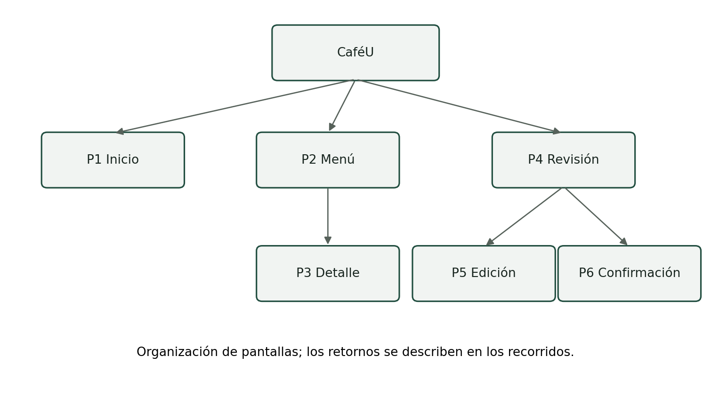
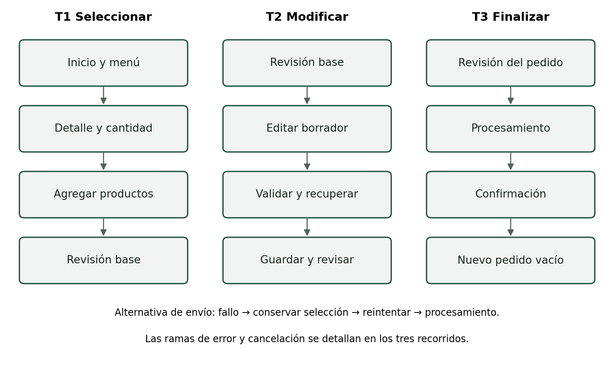

# Arquitectura y diseño visual

| Pantalla | Contenido y decisión de diseño |
| --- | --- |
| P1 Inicio | Identidad y acción Ver menú; inicio sin datos de registro. |
| P2 Menú | Búsqueda, filtros y tarjetas con imagen, nombre, precio y acción específica. |
| P3 Detalle | Información del producto, cantidad, subtotal, restablecer y cancelar. |
| P4 Revisión | Líneas, total y acciones confirmar, editar y seguir comprando. |
| P5 Edición | Borrador, cantidades, quitar, agregar otro producto, guardar y cancelar. |
| P6 Confirmación | Número de pedido, recibido, detalle, total y hacer otro pedido. |

## Aplicación de principios HCI

- **Jerarquía:** el título identifica la actividad; el total y la acción principal destacan la decisión de avance.
- **Proximidad:** los datos de un producto permanecen juntos. La validación se ubica junto al campo que debe corregirse.
- **Similitud:** tarjetas, selectores y acciones conservan estructura y tratamiento entre pantallas.
- **Figura y fondo:** el modal se destaca sobre el fondo oscurecido y mantiene confirmar y cancelar.
- **Continuidad:** la navegación conserva Inicio, Menú y Mi pedido; el contexto de edición se comunica con Borrador y Volver a editar.
- **Carga cognitiva:** cantidades, precios e importes visibles reducen la necesidad de recordarlos. Restablecer a 1 ofrece una salida explícita.

[Recorridos, acciones y resultados](prototipo/recorridos.md). [Estados y microinteracciones](prototipo/estados-y-microinteracciones.md).
