# Capturas de la versión inicial

Se conservan las 30 capturas anteriores a la iteración. E21 repite el estado de borrador vacío de E19; ambos archivos se mantienen como evidencias recibidas. Las imágenes son escenarios, no una sesión continua.

## E01 Inicio con pedido vacío

Acceso al menú y contador 0 antes de seleccionar productos.

Archivo original: `image(20261024-213119).png`.

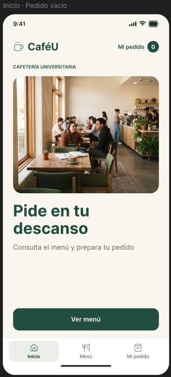

## E02 Menú completo

Catálogo de dos productos con precio, búsqueda y categorías.

Archivo original: `image(20261024-213136).png`.

## E03 Filtro de bebidas

Solo se muestra café; el pedido existente conserva 2 unidades.

Archivo original: `image(20261024-213149).png`.

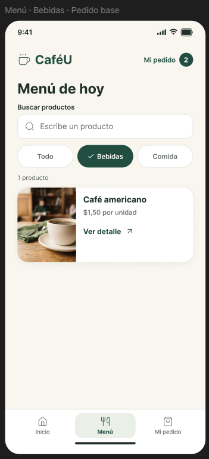

## E04 Filtro de comida

Solo se muestra sanduche; el contador sigue en 2 unidades.

Archivo original: `image(20261024-213200).png`.

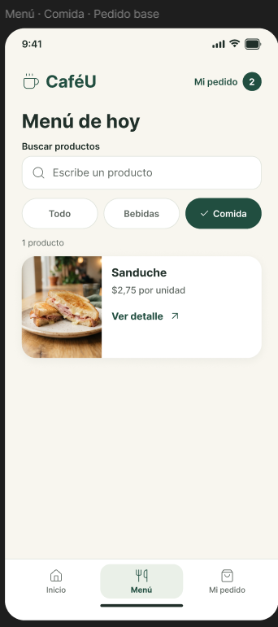

## E05 Búsqueda de café

La consulta tiene foco visible y devuelve una coincidencia.

Archivo original: `image(20261024-213211).png`.

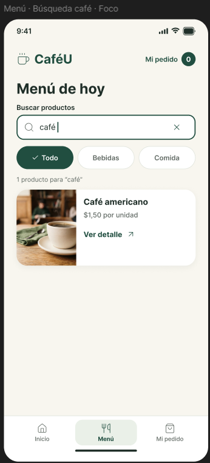

## E06 Búsqueda sin coincidencias

La consulta té muestra una explicación y Limpiar búsqueda.

Archivo original: `image(20261024-213227).png`.

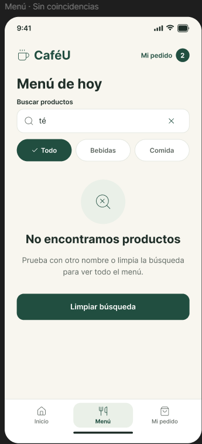

## E07 Detalle de café

Cantidad 1, precio unitario y subtotal de $1,50.

Archivo original: `image(20261024-213255).png`.

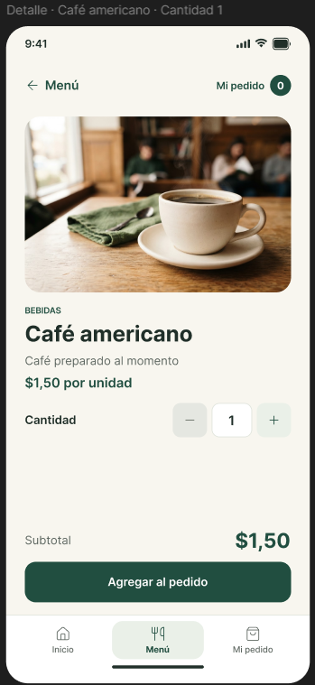

## E08 Detalle de sanduche

Cantidad 1 y subtotal $2,75; ya hay un café en el pedido.

Archivo original: `image(20261024-213318).png`.

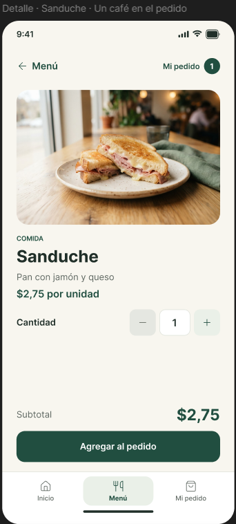

## E09 Cantidad inválida

El valor 0 tiene mensaje, icono y borde; Agregar está deshabilitado.

Archivo original: `image(20261024-213331).png`.

## E10 Cantidad corregida

El valor 2 produce subtotal $3,00 y permite agregar.

Archivo original: `image(20261024-213346).png`.

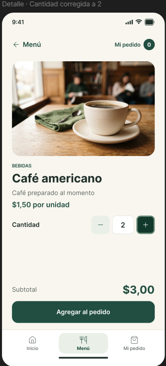

## E11 Producto agregado

La revisión informa el agregado de un café por $1,50.

Archivo original: `image(20261024-213358).png`.

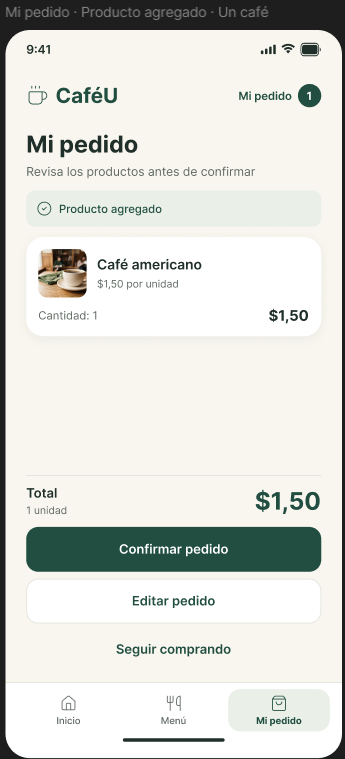

## E12 Pedido base

Un café y un sanduche suman 2 unidades y $4,25.

Archivo original: `image(20261024-213416).png`.

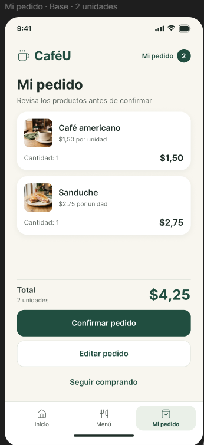

## E13 Pedido vacío

Total $0,00, acceso al catálogo y confirmación deshabilitada.

Archivo original: `image(20261024-213443).png`.

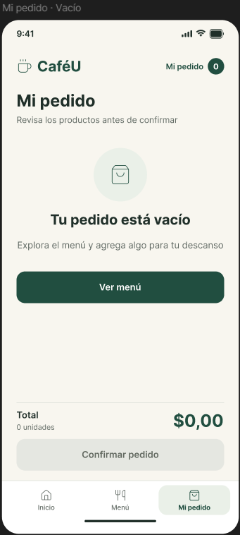

## E14 Borrador base

La edición parte de 2 unidades y $4,25.

Archivo original: `image(20261024-213455).png`.

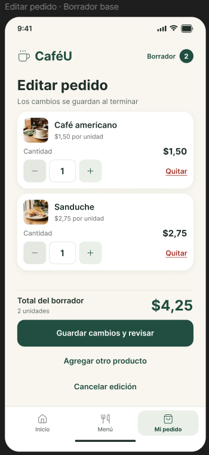

## E15 Borrador modificado

Dos cafés y un sanduche suman 3 unidades y $5,75.

Archivo original: `image(20261024-213515).png`.

## E16 Modal para quitar sanduche

Identifica producto y cantidad; permite cancelar o quitar.

Archivo original: `image(20261024-213535).png`.

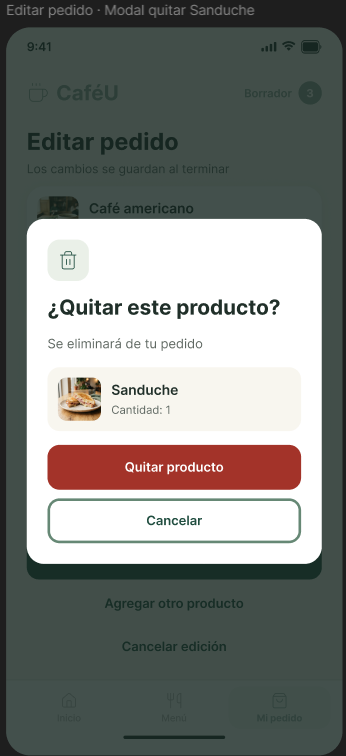

## E17 Sanduche retirado del pedido base

En este escenario queda un café por $1,50.

Archivo original: `image(20261024-213543).png`.

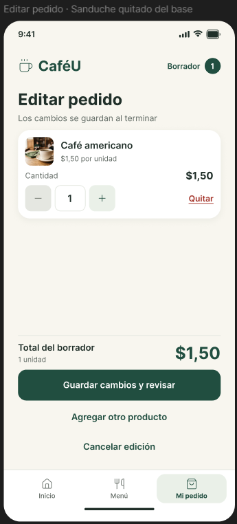

## E18 Modal de descarte

Explica que se recuperaría el pedido de 2 unidades y $4,25.

Archivo original: `image(20261024-213558).png`.

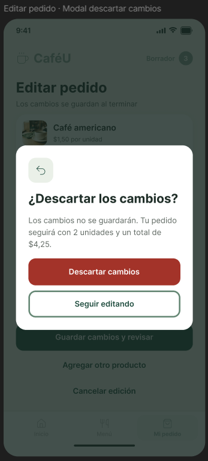

## E19 Borrador vacío

Guardar está deshabilitado; se puede agregar o cancelar.

Archivo original: `image(20261024-213626).png`.

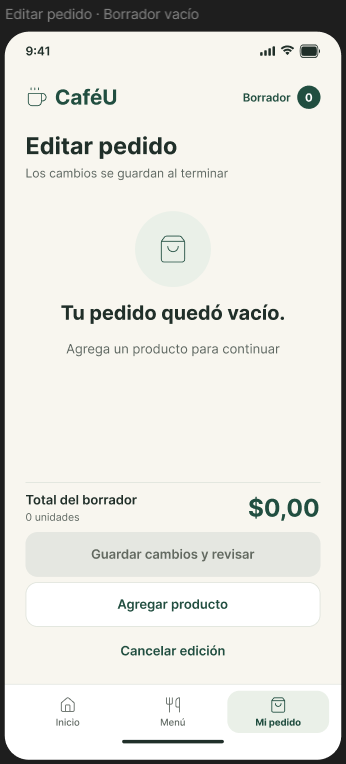

## E20 Catálogo dentro de la edición

El encabezado muestra Borrador 3 y Volver a editar.

Archivo original: `image(20261024-213710).png`.

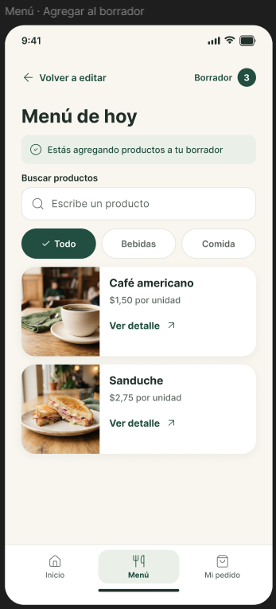

## E21 Borrador vacío repetido

Segunda evidencia del mismo estado lógico mostrado en E19.

Archivo original: `image(20261024-214030).png`.

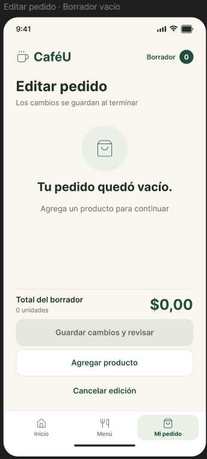

## E22 Cambios guardados

La revisión consolida 3 unidades y $5,75 con retroalimentación.

Archivo original: `image(20261024-214055).png`.

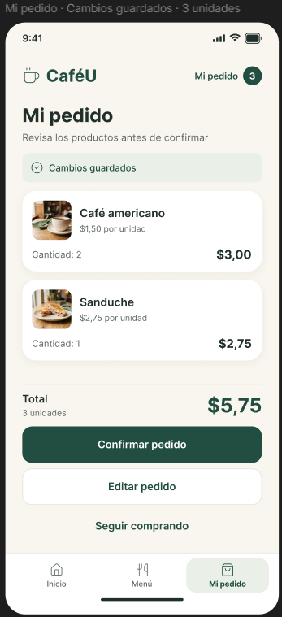

## E23 Procesamiento del pedido base

Se conserva el resumen de $4,25 y las acciones parecen inactivas.

Archivo original: `image(20261024-214112).png`.

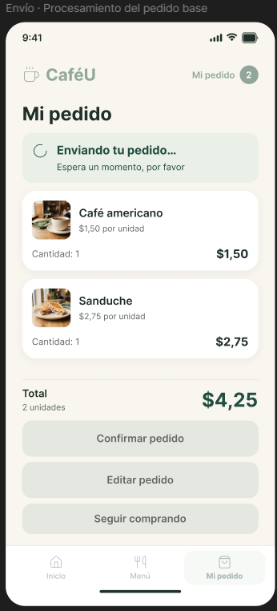

## E24 Fallo con selección conservada

El pedido de $4,25 permanece visible con Reintentar y Volver a revisar.

Archivo original: `image(20261024-214125).png`.

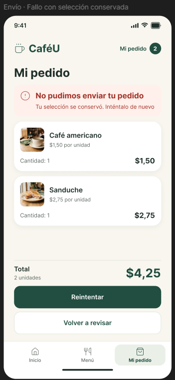

## E25 Reintento en curso

La representación visual coincide con el procesamiento inicial.

Archivo original: `image(20261024-214159).png`.

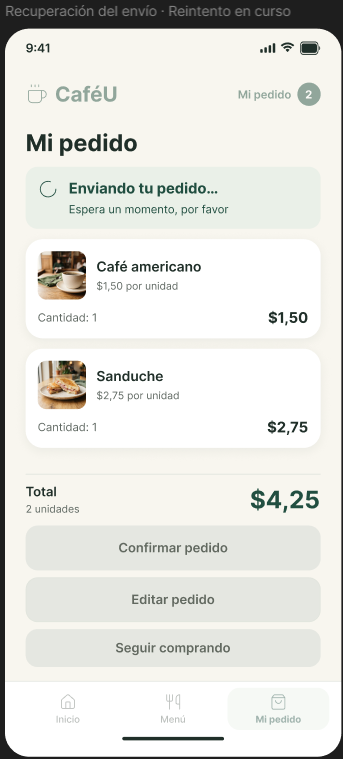

## E26 Confirmación del pedido base

CU-104 recibido por $4,25; el contador de selección está en 0.

Archivo original: `image(20261024-214158).png`.

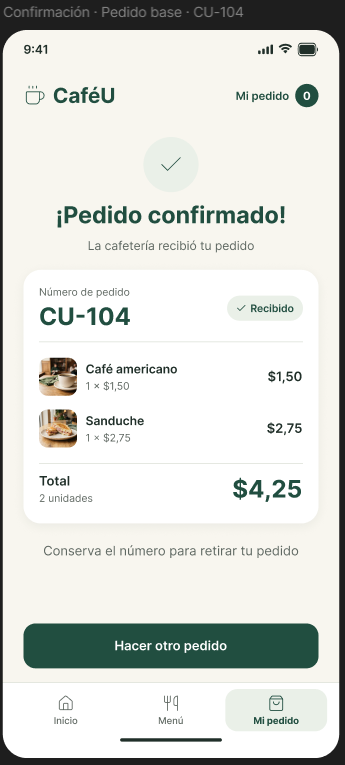

## E27 Procesamiento del pedido modificado

Se conservan 3 unidades y $5,75 durante el envío.

Archivo original: `image(20261024-214218).png`.

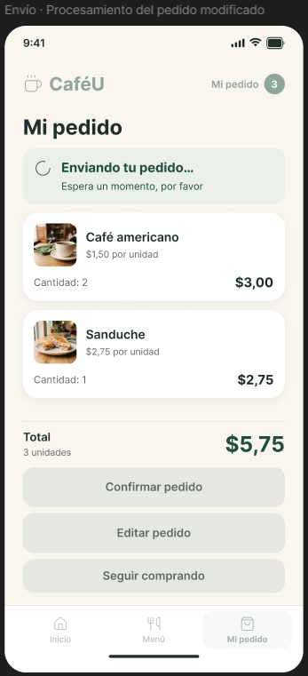

## E28 Confirmación alternativa modificada

CU-104 recibido por $5,75; variante del primer pedido.

Archivo original: `image(20261024-214234).png`.

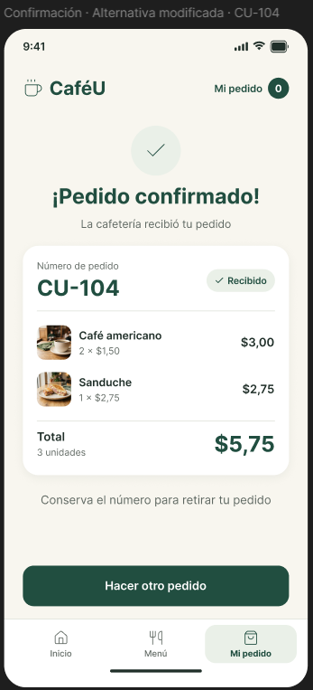

## E29 Catálogo para otro pedido

El menú vuelve a mostrar contador 0 y los dos productos.

Archivo original: `image(20261024-214256).png`.

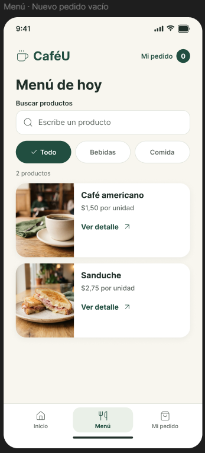

## E30 Confirmación del siguiente pedido

CU-105 contiene un café y total $1,50.

Archivo original: `image(20261024-214307).png`.

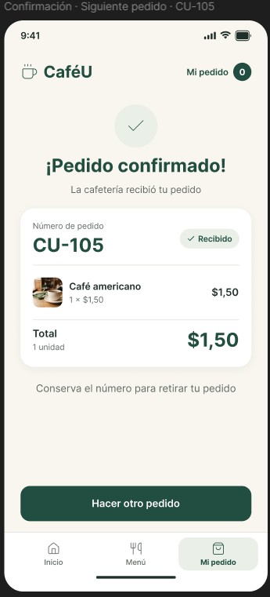
