# Capturas de la versión corregida

Índice C01–C33 utilizado en el informe. Cada entrada identifica la pantalla y el escenario. Los contadores y totales pertenecen al estado de cada captura.

## C01 P1 Inicio vacío

Acceso al menú y contador 0 antes de preparar una selección.

Archivo original: `image(20261025-004147).png`.

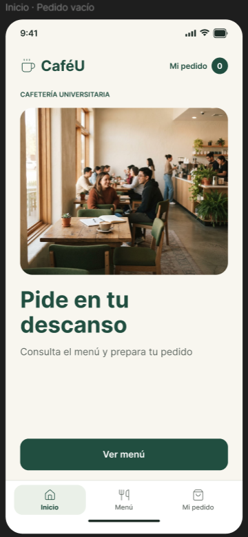

## C02 P2 Menú completo

Dos productos, precios y acciones con el nombre de cada producto.

Archivo original: `image(20261025-004201).png`.

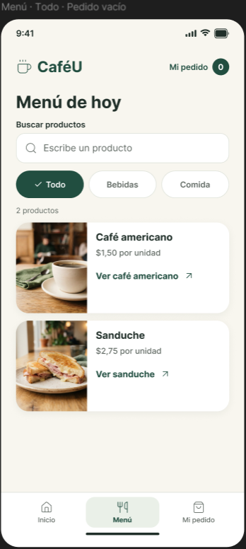

## C03 P2 Filtro bebidas

Una coincidencia de café; la selección base conserva 2 unidades.

Archivo original: `image(20261025-004214).png`.

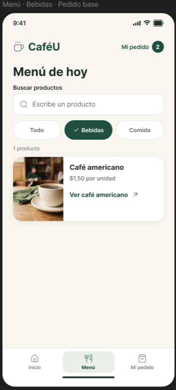

## C04 P2 Filtro comida

Una coincidencia de sanduche; el contador conserva 2 unidades.

Archivo original: `image(20261025-004231).png`.

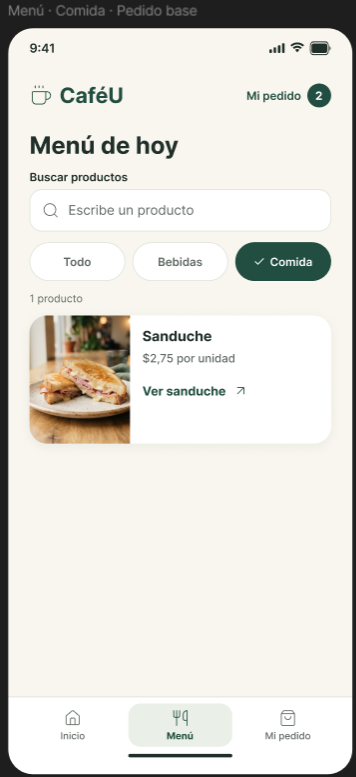

## C05 P2 Búsqueda de café

Campo con foco visible y resultado que coincide con la consulta.

Archivo original: `image(20261025-004239).png`.

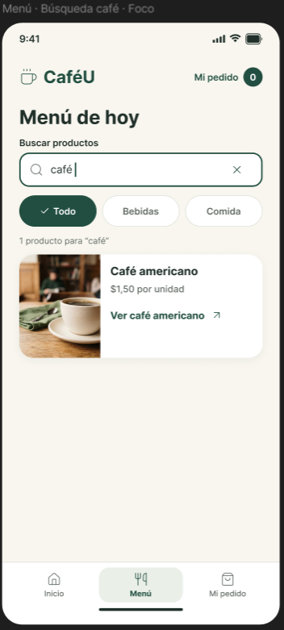

## C06 P2 Búsqueda sin resultados

La consulta té muestra explicación y permite limpiar la búsqueda.

Archivo original: `image(20261025-004249).png`.

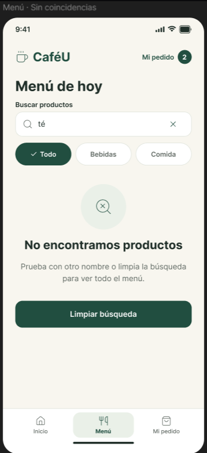

## C07 P3 Detalle de café

Cantidad 1 y subtotal $1,50; incluye restablecer y cancelar.

Archivo original: `image(20261025-004322).png`.

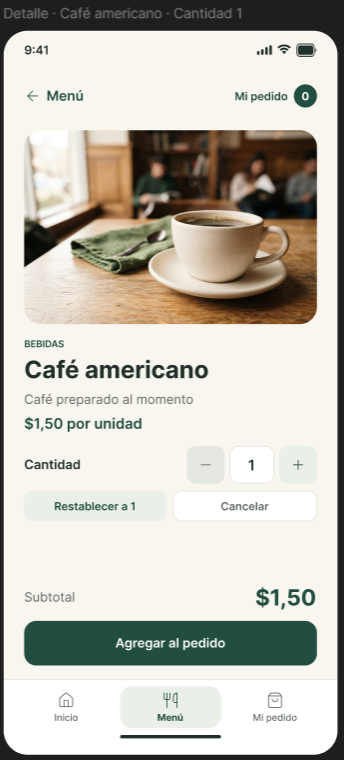

## C08 P3 Detalle de sanduche

Cantidad 1 y subtotal $2,75; existe un café en la selección.

Archivo original: `image(20261025-004335).png`.

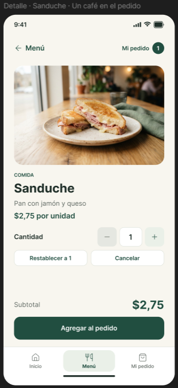

## C09 P3 Cantidad cero inválida

Regla textual, restablecimiento y agregado inactivo; subtotal no calculado.

Archivo original: `image(20261025-004348).png`.

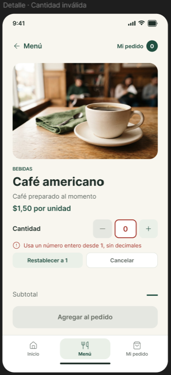

## C10 P3 Cantidad válida 2

Dos cafés producen $3,00; el agregado vuelve a representarse activo.

Archivo original: `image(20261025-004400).png`.

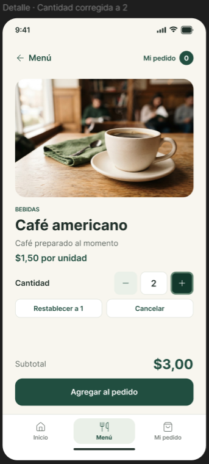

## C11 P4 Café agregado

El mensaje nombra 1 café americano y la revisión muestra $1,50.

Archivo original: `image(20261025-004504).png`.

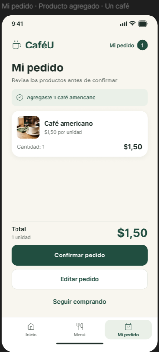

## C12 P4 Pedido base

1 café + 1 sanduche; 2 unidades; $4,25. El texto identifica el sanduche agregado.

Archivo original: `image(20261025-004514).png`.

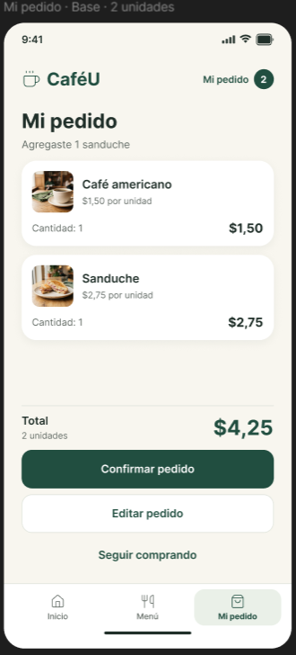

## C13 P4 Pedido vacío

0 unidades y $0,00; se ofrece ver menú y confirmar aparece inactivo.

Archivo original: `image(20261025-004532).png`.

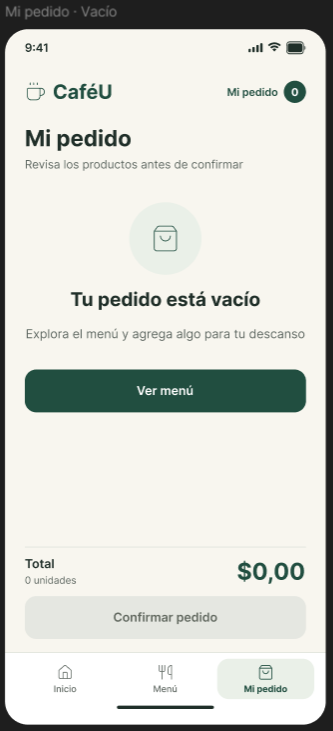

## C14 P5 Edición inicial

Aviso de guardado manual, edición en curso y restablecimiento en cada línea.

Archivo original: `image(20261025-004554).png`.

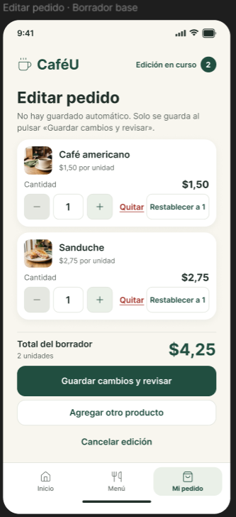

## C15 P5 Borrador de 3 unidades

Cambios sin guardar; 2 cafés + 1 sanduche; $5,75; multiplicación por precio.

Archivo original: `image(20261025-004615).png`.

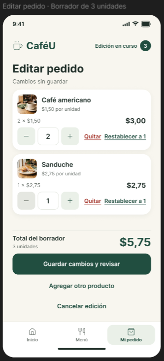

## C16 P5 Confirmar eliminación

Modal que identifica el sanduche y permite quitar o cancelar.

Archivo original: `image(20261025-004631).png`.

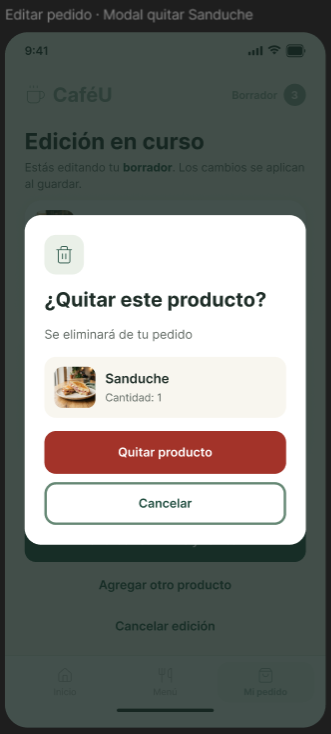

## C17 P5 Sanduche retirado del base

Rama independiente: queda 1 café por $1,50 y cambios sin guardar.

Archivo original: `image(20261025-004654).png`.

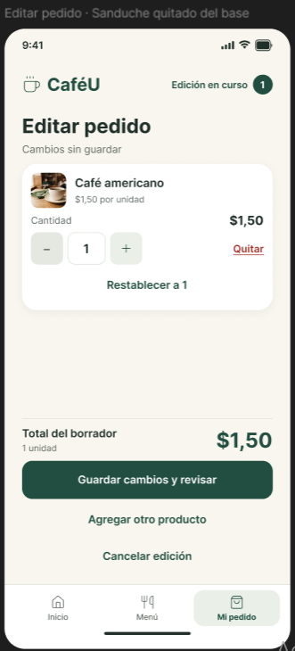

## C18 P5 Descartar cambios

Modal informa que se conservarían las 2 unidades del pedido guardado por $4,25.

Archivo original: `image(20261025-004711).png`.

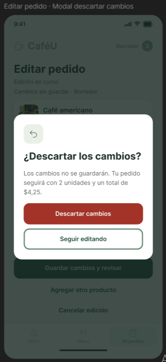

## C19 P5 Borrador vacío

Guardar inactivo; permite agregar producto o cancelar la edición.

Archivo original: `image(20261025-004748).png`.

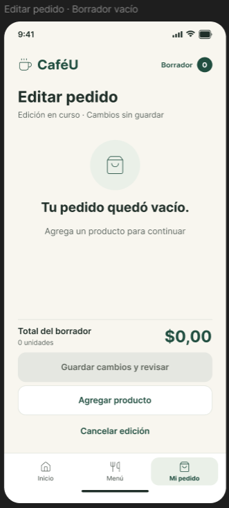

## C20 P2 Catálogo desde la edición

Se informa que los productos se agregan al borrador; acceso «Volver a editar».

Archivo original: `image(20261025-004803).png`.

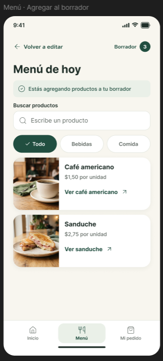

## C21 P4 Cambios guardados

Mensaje explícito de consolidación; 3 unidades y $5,75 en la revisión.

Archivo original: `image(20261025-005107).png`.

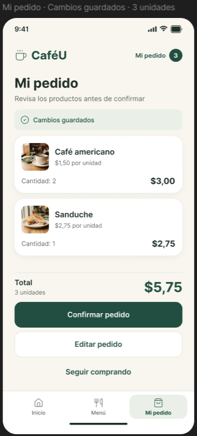

## C22 P4 Envío del pedido base

Procesamiento con resumen de $4,25 y acciones visualmente inactivas.

Archivo original: `image(20261025-005119).png`.

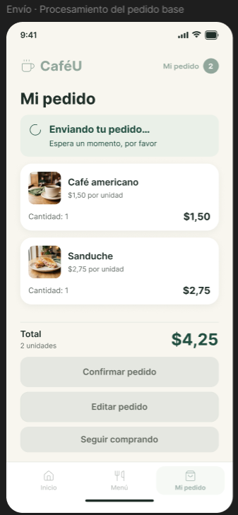

## C23 P4 Fallo de envío

Selección conservada por $4,25; reintentar o volver a revisar.

Archivo original: `image(20261025-005132).png`.

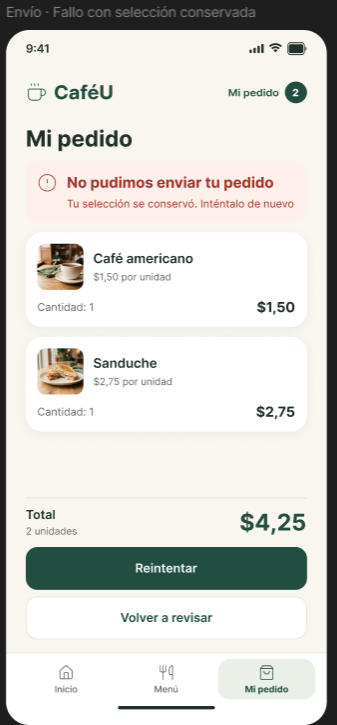

## C24 P4 Reintento en curso

Reutiliza «Enviando tu pedido…» y conserva el resumen base.

Archivo original: `image(20261025-005142).png`.

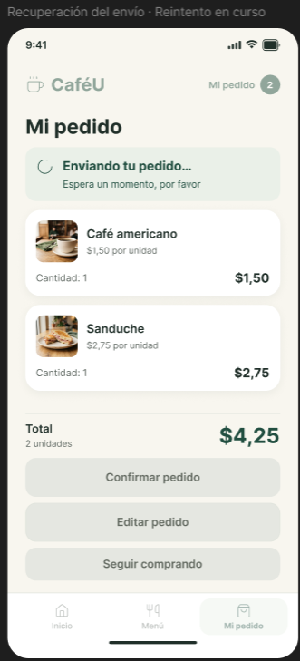

## C25 P6 CU-104 base

Pedido recibido de 2 unidades por $4,25; selección activa en 0.

Archivo original: `image(20261025-005202).png`.

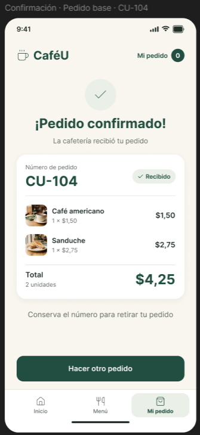

## C26 P4 Envío del modificado

Variante con 3 unidades y $5,75 durante el procesamiento.

Archivo original: `image(20261025-005215).png`.

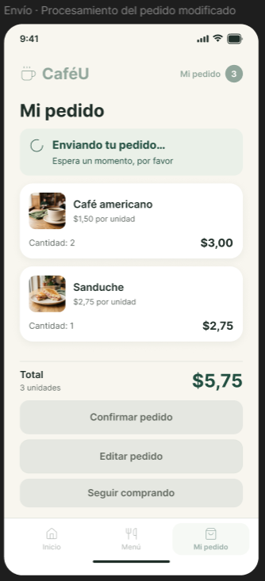

## C27 P6 CU-104 modificado

Variante alternativa del primer comprobante: 3 unidades y $5,75.

Archivo original: `image(20261025-005226).png`.

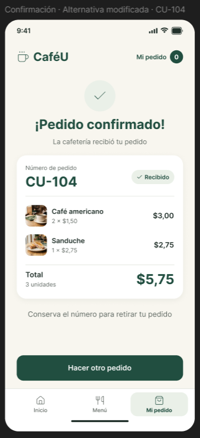

## C28 P2 Nuevo pedido vacío

El menú vuelve al contador 0 después de iniciar otro pedido.

Archivo original: `image(20261025-005236).png`.

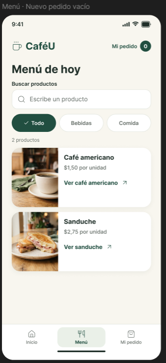

## C29 P6 Siguiente pedido CU-105

Nuevo comprobante con 1 café y $1,50; no es el pedido base.

Archivo original: `image(20261025-005248).png`.

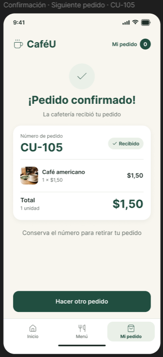

## C30 P5 Cantidad vacía en edición

Regla junto al campo, restablecer, importes no calculados y guardar inactivo.

Archivo original: `image(20261025-005314).png`.

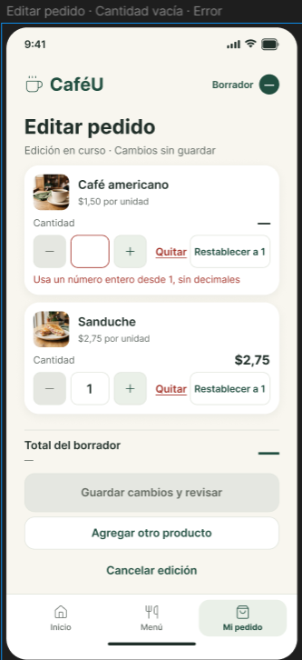

## C31 P5 Borrador de 4 unidades

3 cafés + 1 sanduche; $7,25. Permite reconocer el incremento adicional.

Archivo original: `image(20261025-005325).png`.

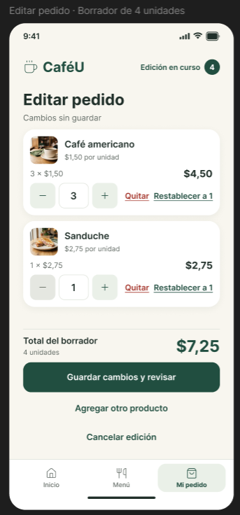

## C32 P3 Café desde el borrador

El contexto se mantiene: «Volver a editar», «Borrador» y «Agregar al borrador».

Archivo original: `image(20261025-005336).png`.

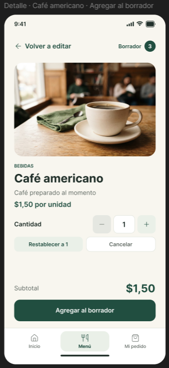

## C33 P3 Sanduche desde el borrador

Mismo contexto de edición para el sanduche, con restablecer y cancelar.

Archivo original: `image(20261025-005348).png`.

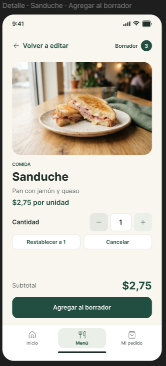
