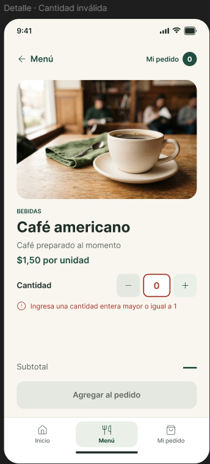
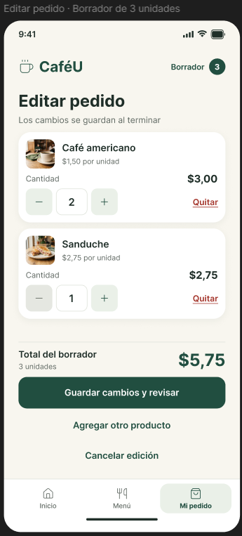
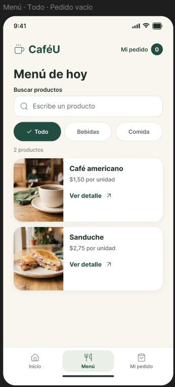

# Iteración y comparación antes después

Se conservan seis pantallas y los mismos productos y precios. K01–K04 responden a D01–D04. D05 continúa como recomendación. Las tres primeras comparaciones constituyen los cambios principales exigidos por la actividad.

## K01 Recuperar una cantidad válida

**Origen:** D01 · P01 T2.

El detalle inicial señalaba el error, pero no ofrecía restablecimiento directo. La versión corregida añade Restablecer a 1 y explicita la regla de entero; C30 cubre además la cantidad vacía en edición.

**Antes E09**

**Después C09**

**Criterio de aceptación:** Cantidad vacía o cero con mensaje junto al campo; recuperación visible; importe no calculado y consolidación inactiva mientras el dato sea inválido.

## K02 Distinguir edición y guardado

**Origen:** D02 · P01 T2.

El texto inicial no destacaba los cambios pendientes como la versión corregida. Edición en curso y Cambios sin guardar aclaran el estado. C14 explica que no hay guardado automático y C21 informa Cambios guardados.

**Antes E15**

**Después C15**

**Criterio de aceptación:** El borrador se distingue del pedido consolidado; al guardar el objetivo se representa 3 unidades y $5,75.

## K03 Identificar el producto seleccionado

**Origen:** D03 · P01 T1.

Ver detalle se sustituye por Ver café americano y Ver sanduche. C11–C12 nombran el agregado. El cambio refuerza la correspondencia entre tarjeta, acción y resultado.

**Antes E02**

**Después C02**

**Criterio de aceptación:** El acceso y el aviso identifican el producto correspondiente a la línea de revisión.

## K04 Hacer visible cantidad e importe

**Origen:** D04 · P02 T2.

La edición añade la multiplicación por precio unitario. C31 muestra 3 cafés y 1 sanduche: 4 unidades y $7,25. C15 representa 2 cafés y 1 sanduche: 3 unidades y $5,75. El incremento adicional puede reconocerse antes de guardar.

**Antes E15**

**Después C15**

**Criterio de aceptación:** Cantidad, precio, subtotal y total coherentes; no se atribuye un defecto de duplicación de eventos al botón.

## Estados complementarios

- [C30 Cantidad vacía](../evidencias/despues/C30_cantidad-vacia-en-edicion.png): regla, restablecer, importes no calculados y guardar inactivo.
- [C31 Incremento adicional](../evidencias/despues/C31_borrador-de-4-unidades.png): 3 cafés y un sanduche por $7,25.
- [C21 Cambios guardados](../evidencias/despues/C21_cambios-guardados.png): consolidación del objetivo por $5,75.

La verificación de la incorporación es visual. No se dispone de mediciones posteriores con participantes; por ello no se calcula una reducción de tiempo o errores.
