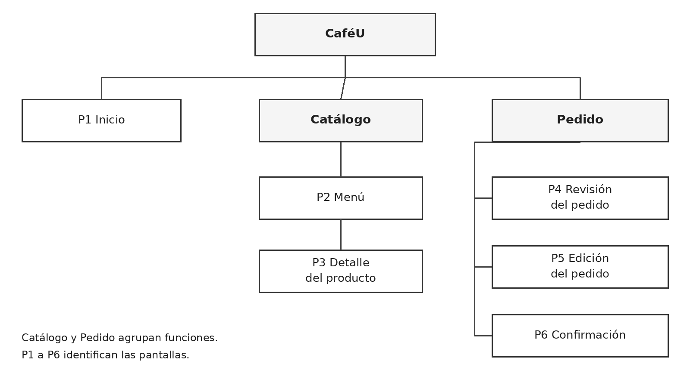
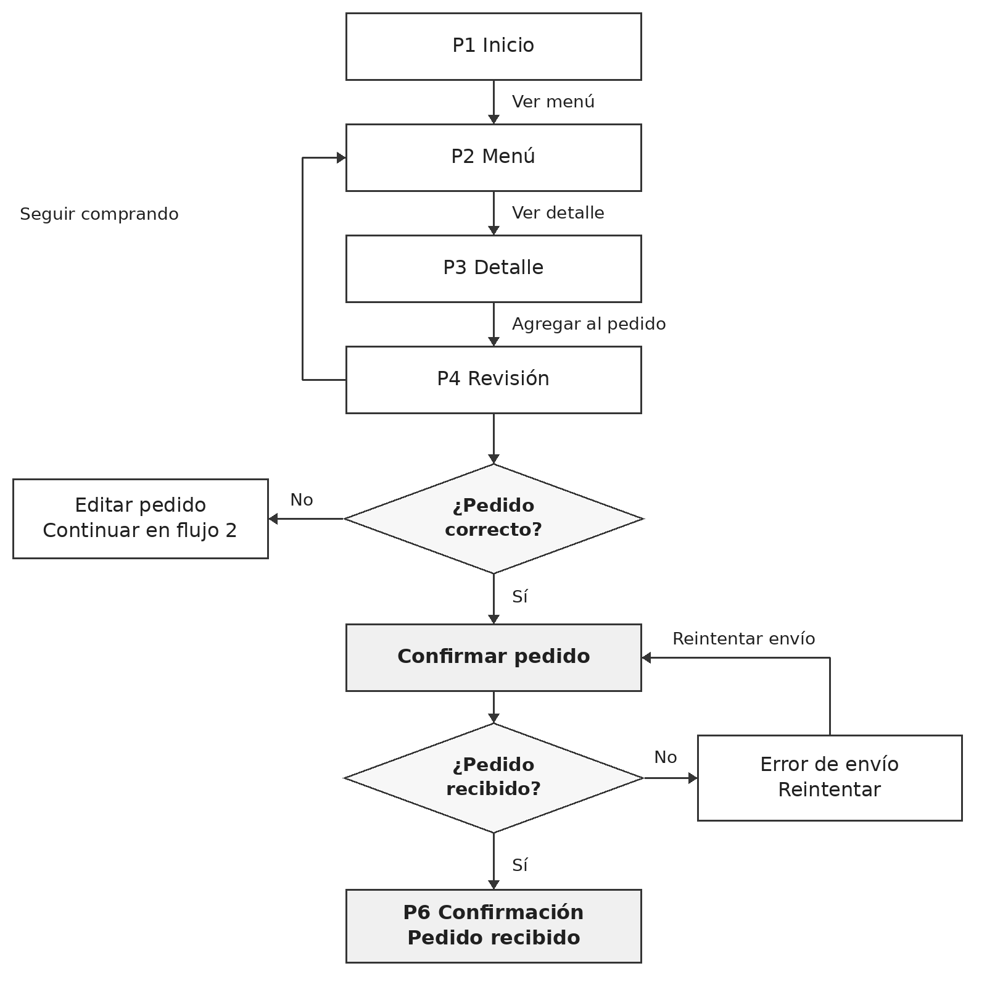
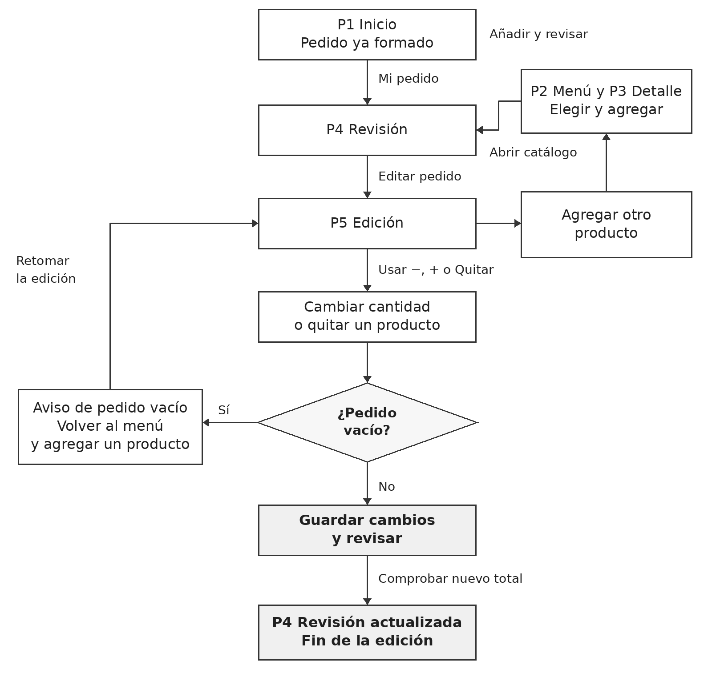

# Sitemap y flujos de usuario

## Arquitectura de información

Inicio es el punto de entrada. Catálogo agrupa Menú y Detalle del producto; Pedido agrupa Revisión, Edición y Confirmación. Catálogo y Pedido son agrupaciones funcionales, no pantallas adicionales.

## Flujo 1: formar, revisar y confirmar un pedido

Comienza en Inicio con un pedido vacío. El estudiante consulta el menú, selecciona productos y revisa el total. Puede seguir comprando o editar. Termina cuando la interfaz comunica que el pedido fue recibido. El diagrama incluye un error de envío y la alternativa de reintento.

## Flujo 2: editar un pedido antes de confirmarlo

Parte de un pedido ya formado. El estudiante abre Mi pedido, entra a Edición y modifica cantidades o quita productos. También puede agregar otra opción. Termina al regresar a Revisión con el estado actualizado. Si la selección queda vacía, se especifica un aviso y un retorno al menú.

