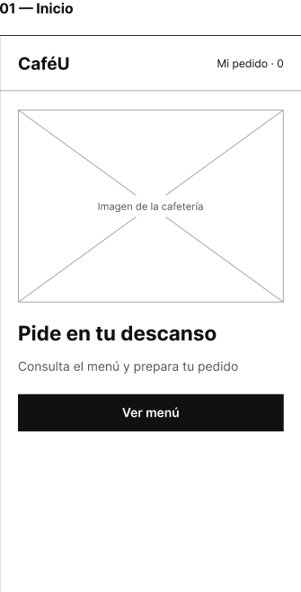
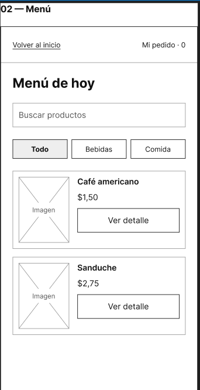
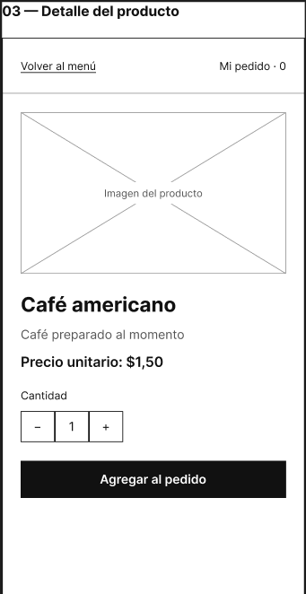
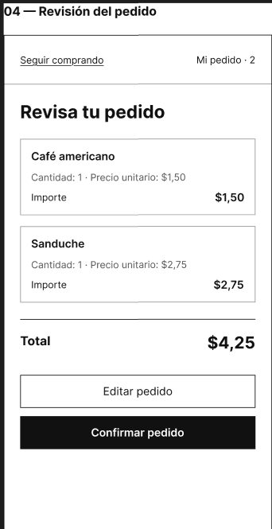
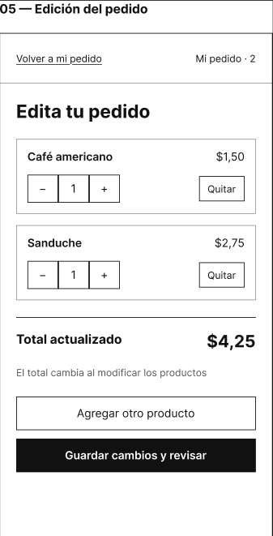
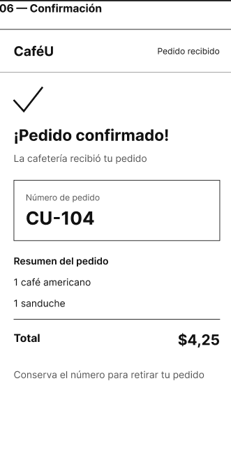

# Wireframes de baja fidelidad

Las siguientes capturas corresponden al diseño de CaféU en Figma.

## P1 Inicio

Presenta CaféU, Ver menú y el indicador Mi pedido.

## P2 Menú

Muestra productos, precios, búsqueda, filtros y Ver detalle.

## P3 Detalle del producto

Permite revisar el café americano y elegir la cantidad antes de agregarlo.

## P4 Revisión del pedido

Muestra una unidad de café y una de sanduche, el total de $4,25 y las acciones Editar y Confirmar.

## P5 Edición del pedido

Presenta controles de cantidad, Quitar, total actualizado y retorno a la revisión.

## P6 Confirmación del pedido

Comunica la recepción, muestra CU-104 y conserva el resumen de $4,25.

