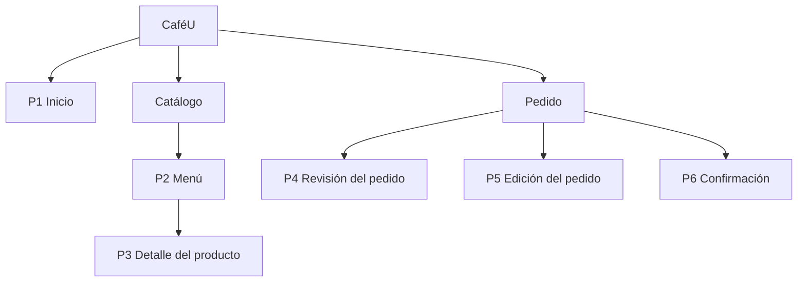
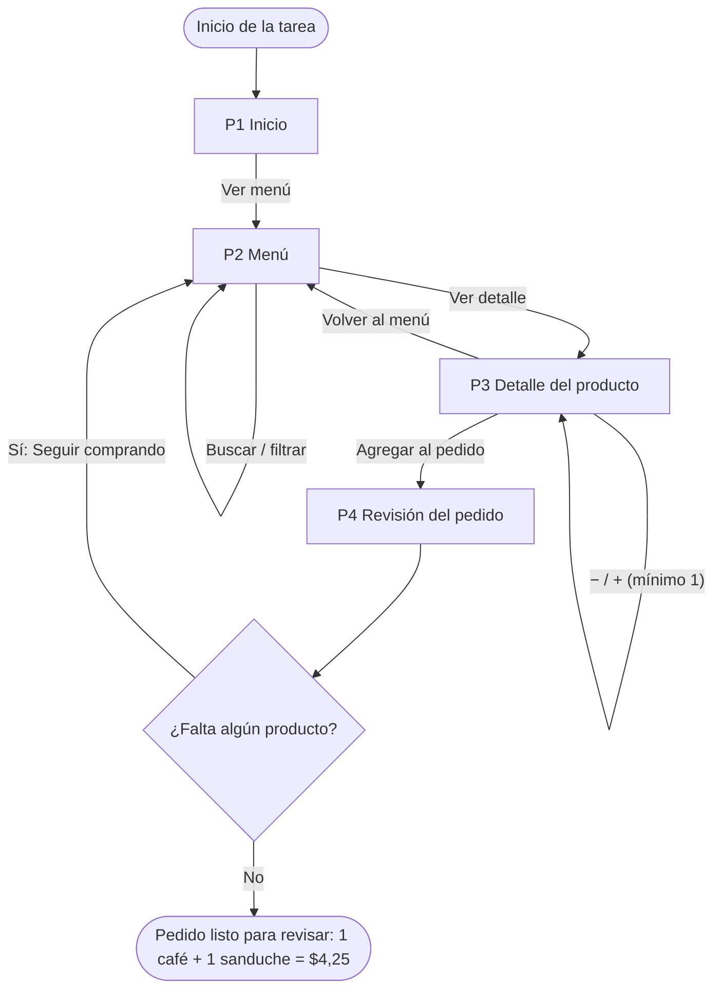
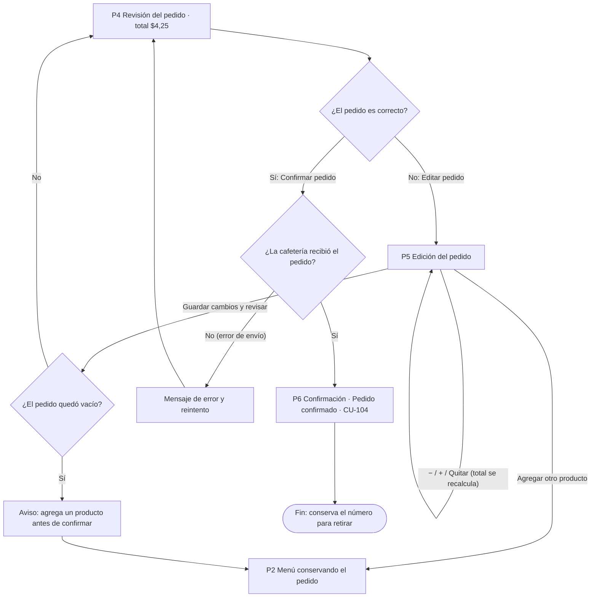

# APE 4 · Fase 1 — CaféU

**De los requisitos a la arquitectura de información, navegación y wireframes**

Universidad Técnica de Ambato · FISEI · Carrera de Software
Interacción Humano Computador · Quinto A · Grupo 6
Docente: Ing. José Rubén Caiza Caizabuano · Ciclo julio – diciembre 2026

| Integrantes |
|---|
| Abril, Emilio |
| Cusme, Manuel |
| Gamboa, Jonathan |
| Lozada, Pablo |
| Martínez Jiménez, William Fernando |

🔗 **Archivo de Figma:** [Wireframes de CaféU](https://www.figma.com/design/dhCepBRVzTM35Tzk3Dpgas/Sin-t%C3%ADtulo?node-id=0-1&t=4mWSAkJPEffNSNga-1)

---

## 1. Caso

CaféU es una cafetería universitaria ficticia. Un estudiante con poco tiempo durante su descanso necesita consultar el menú y hacer un pedido sin explicarlo verbalmente mientras espera en una fila concurrida.

**Escenario de revisión:** 1 café americano ($1,50) + 1 sanduche ($2,75) = **$4,25**. Desde la revisión del pedido la persona puede **confirmar** (recibe una señal clara de recepción) o **editar** (corrige productos o cantidades y vuelve a revisar el total).

## 2. Proceso didáctico

```
Requisito → Pantalla → Sitemap → User flow → Navegación / Componentes → Wireframe
```

Ejemplo con un requisito real del caso:

| Etapa | CaféU |
|---|---|
| Requisito | RF04 – El estudiante necesita revisar su pedido antes de confirmarlo. |
| Pantalla | P4 Revisión del pedido. |
| Sitemap | CaféU → Pedido → Revisión del pedido. |
| User flow | Inicio → Ver menú → Ver detalle → Agregar al pedido → **Revisión** → Confirmar / Editar. |
| Componentes | Resumen de líneas (cantidad, precio, importe), total, botones *Confirmar pedido* y *Editar pedido*, indicador *Mi pedido*. |
| Wireframe | Pantalla P4 en Figma con las dos líneas del pedido, el total de $4,25 y ambas acciones. |

## 3. Análisis de requisitos — matriz de requisitos, usuarios y pantallas

**Usuario principal:** estudiante universitario con poco tiempo en su descanso.
**Necesidad:** ver productos y precios, armar su pedido rápido, comprobar el total y saber que la cafetería lo recibió.

| Código | Requisito funcional | Usuario / necesidad | Pantalla | Control o evidencia |
|---|---|---|---|---|
| RF01 | Consultar el menú con productos y precios | Saber qué hay y cuánto cuesta | P2 Menú | Tarjetas, nombres, precios, búsqueda y filtros |
| RF02 | Consultar el detalle y elegir cantidad | Comprobar el producto antes de pedir | P3 Detalle | Descripción, precio, selector − / + |
| RF03 | Agregar productos al pedido | Armar el pedido sin hablar | P3 Detalle | *Agregar al pedido* |
| RF04 | Revisar el pedido antes de confirmarlo | Evitar errores de cantidad o total | P4 Revisión | Unidades, importes y total |
| RF05 | Editar productos o cantidades | Corregir una selección | P5 Edición | −, +, *Quitar*, *Guardar cambios y revisar* |
| RF06 | Confirmar el pedido revisado | Enviar el pedido | P4 Revisión | *Confirmar pedido* |
| RF07 | Mostrar una señal clara de recepción | Saber que el pedido llegó | P6 Confirmación | *Pedido confirmado*, número CU-104 y resumen |
| RF08 | Volver al menú conservando lo seleccionado | Seguir comprando sin perder lo elegido | P4 y P5 | *Seguir comprando*, *Agregar otro producto* |

## 4. Sitemap

Inicio es el punto de entrada. **Catálogo** reúne la consulta (Menú y Detalle) y **Pedido** agrupa la gestión (Revisión, Edición y Confirmación). Catálogo y Pedido son agrupaciones de funciones, no pantallas adicionales.



| Pantalla | Tipo | Contenido principal |
|---|---|---|
| P1 Inicio | Principal | Identidad de CaféU y acceso al menú |
| P2 Menú | Principal | Productos, precios, búsqueda y categorías |
| P3 Detalle | Secundaria | Información del producto y cantidad |
| P4 Revisión | Principal | Productos, cantidades, importes y total |
| P5 Edición | Secundaria | Ajustes del pedido y regreso a revisión |
| P6 Confirmación | Secundaria | Recepción del pedido, número y resumen |

## 5. User flows

### Flujo 1 — Consultar el menú y armar el pedido



### Flujo 2 — Revisar, editar y confirmar el pedido



> El estado de pedido vacío y el error de envío son reglas de comportamiento previstas; no son pantallas adicionales elaboradas en Figma.

## 6. Navegación

Navegación lineal guiada por la tarea, con retornos para corregir y el indicador **Mi pedido** como acceso directo al resumen.

| Origen | Control | Destino |
|---|---|---|
| P1 Inicio | Ver menú | P2 Menú |
| P2 Menú | Volver al inicio | P1 Inicio |
| P2 Menú | Ver detalle | P3 Detalle del producto elegido |
| P1 a P3 | Mi pedido | P4 Revisión |
| P3 Detalle | Volver al menú | P2 Menú |
| P3 Detalle | Agregar al pedido | P4 Revisión con el producto agregado |
| P4 Revisión | Seguir comprando | P2 Menú conservando el pedido |
| P4 Revisión | Editar pedido | P5 Edición |
| P4 Revisión | Confirmar pedido | P6 Confirmación tras la recepción |
| P5 Edición | Volver a mi pedido | P4 Revisión |
| P5 Edición | Agregar otro producto | P2 Menú conservando el pedido |
| P5 Edición | Guardar cambios y revisar | P4 Revisión actualizada |

## 7. Inventario de componentes

| Componente | Pantallas | Función |
|---|---|---|
| Encabezado y retorno | P1 a P6 | Identificar CaféU o volver a la pantalla anterior |
| Indicador *Mi pedido* | P1 a P5 | Mostrar unidades y abrir el resumen |
| Campo de búsqueda | P2 | Localizar productos por nombre |
| Filtros de categoría | P2 | Todo, Bebidas, Comida |
| Tarjeta de producto | P2 | Imagen, nombre, precio y *Ver detalle* |
| Selector de cantidad | P3, P5 | Aumentar o disminuir unidades con − y + |
| Botón *Quitar* | P5 | Retirar una línea del pedido |
| Resumen y total | P4 a P6 | Productos e importe del pedido |
| Botón de acción principal | P1, P3, P4, P5 | Avanzar en la tarea con un texto claro |
| Mensaje de confirmación y número | P6 | Comunicar la recepción e identificar el pedido |

**Reglas de interacción**

1. Total = Σ (cantidad × precio unitario).
2. El selector solo admite enteros positivos; *Quitar* elimina la línea.
3. Búsqueda y filtros no borran lo seleccionado.
4. Volver al menú conserva el pedido.
5. *Guardar cambios y revisar* muestra el resumen actualizado antes de confirmar.

## 8. Wireframes de baja fidelidad

Seis pantallas elaboradas en Figma en blanco, negro y grises; las cajas con diagonales representan imágenes.

| # | Pantalla | Pregunta clave que resuelve |
|---|---|---|
| P1 | Inicio | ¿Dónde empiezo? → *Ver menú* |
| P2 | Menú | ¿Qué hay y cuánto cuesta? → tarjetas con precio |
| P3 | Detalle del producto | ¿Cuántas unidades? → − / + y *Agregar al pedido* |
| P4 | Revisión del pedido | ¿Está bien mi pedido? → total $4,25, *Confirmar* / *Editar* |
| P5 | Edición del pedido | ¿Cómo lo corrijo? → − / +, *Quitar*, *Guardar cambios y revisar* |
| P6 | Confirmación | ¿Lo recibieron? → *Pedido confirmado*, CU-104 |

## 9. Criterios de diseño aplicados

| Criterio | Aplicación en CaféU |
|---|---|
| Jerarquía visual | El título identifica la tarea y el total se destaca antes de confirmar |
| Consistencia | Mismos nombres, precios y controles en las seis pantallas |
| Lenguaje familiar | *Menú*, *Mi pedido*, *Quitar*, *Confirmar pedido* |
| Control del usuario | *Editar pedido*, *Seguir comprando* y retornos |
| Reconocimiento antes que recuerdo | Productos, cantidades e importes visibles en la revisión |
| Prevención de errores | Revisión obligatoria del total antes de confirmar |
| Visibilidad del estado | *Mi pedido · n*, *Pedido confirmado* y número CU-104 |
| Simplicidad | Una acción principal por pantalla |

## 10. Preguntas para la defensa

**¿Cómo transformaron los requisitos en pantallas y componentes?**
Cada acción del enunciado se convirtió en un requisito (RF01–RF08), cada requisito se asignó a una pantalla y a un control concreto (sección 3) y la trazabilidad comprueba que ninguno quede sin representación.

**¿Qué criterios usaron para el sitemap y los recorridos?**
Separar las dos necesidades del estudiante: *saber qué puede pedir* (Catálogo) y *gestionar lo que ya eligió* (Pedido). Los flujos siguen el orden real de la tarea e incluyen las decisiones de confirmar o editar.

**¿Cómo mejoran los wireframes la usabilidad y reducen la carga cognitiva?**
Una acción principal por pantalla, precios y total siempre visibles, etiquetas que describen la acción, retornos que permiten corregir sin empezar de nuevo y una confirmación con número que elimina la duda de si el pedido llegó.

## 11. Contenido de la carpeta `APE4_Fase1`

1. Matriz de requisitos y pantallas — sección 3
2. Sitemap — sección 4
3. Dos diagramas de user flow — sección 5
4. Esquema de navegación e inventario de componentes — secciones 6 y 7
5. Wireframes de baja fidelidad — sección 8 y archivo de Figma
6. Documento PDF con la explicación didáctica del proceso
7. Enlace al archivo de Figma — al inicio de este README

